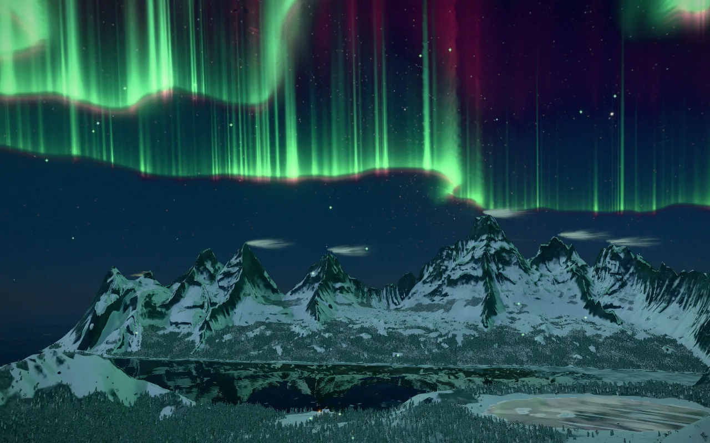
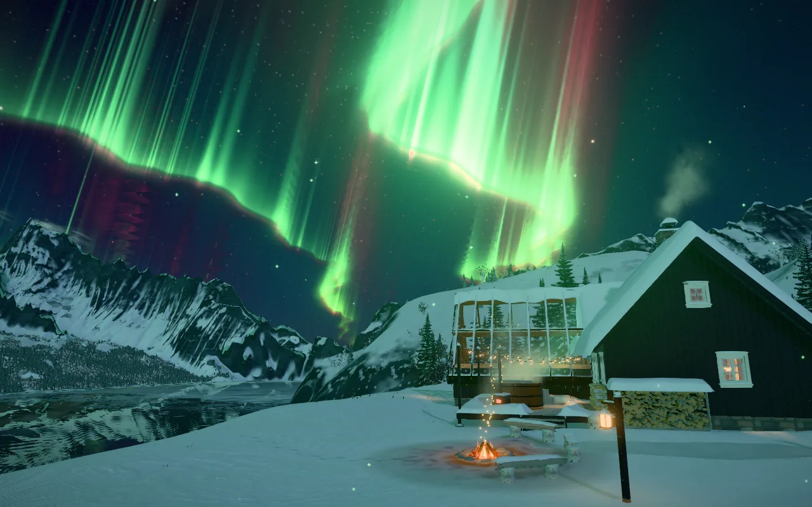

# Foxfire Fjord

<a href="https://orbworlds.com/orb/foxfire-fjord?utm_source=github&utm_medium=readme&utm_campaign=foxfire-fjord"></a>

You arrive at night on a small Arctic island. The northern lights move over the peaks across a frozen fjord, the cabin windows are lit and there's smoke coming out of the chimney. Walk down to the frozen lake, sit in the hot spring, visit the red fishing village, follow the fox's tracks up Fox Peak, or wind the clock forward to a short pink polar day.

The name comes from the Finnish word for the northern lights, revontulet, "fox fires". The story goes that an arctic fox running over the fells sweeps snow into the sky with its tail, and the sparks become the lights. [DESIGN.md](DESIGN.md) has the rest of the thinking behind it.

**[Play it on Orb](https://orbworlds.com/orb/foxfire-fjord?utm_source=github&utm_medium=readme&utm_campaign=foxfire-fjord)**. It runs in the browser on a computer, phone or tablet, and you
don't need an account.

<p>
  
  
</p>

## Controls

WASD to walk, F to fly, T to let time run, G for a guided tour, ? for every control.

## Run it yourself

```bash
git clone https://github.com/orbworlds/foxfire-fjord
cd foxfire-fjord
npm install
npm run dev     # work on it, with the page reloading as you save
npm start       # play it the way Orb serves it, through the Orb kit
```

`npm start` packages the world into `.orb/` and opens it at http://127.0.0.1:4242 with the
Orb kit (`npm install` brings it), which gives it what it gets on Orb: other
players (open a second tab), saves and shared state. You need Node 20 or newer.

What it uses from Orb's world SDK (`window.orb`, typed in [`orb.d.ts`](https://orbworlds.com/kit/orb.d.ts)):

- `orb.visitors` to show everyone who is here as a character
- plain `localStorage` for progress, which Orb saves per player and brings along to their other devices

Outside Orb and the kit, `window.orb` isn't there and the world carries on without it.

## Make your own version

You can remix it on Orb without touching code: [open it there](https://orbworlds.com/orb/foxfire-fjord?remix&utm_source=github&utm_medium=readme&utm_campaign=foxfire-fjord), choose
**Make my own copy** and describe what you'd change. Orb's AI makes the changes in your copy.

Or fork this repository, make your changes and push them. `npm run share` then prints a link that
brings your fork into Orb as a world of your own, credited as a remix of this one, and it stays in
sync with your fork from then on.

## Contributing

Pull requests are welcome. GitHub checks each one by running the world in a headless browser, which has to go without errors,
and once a change is merged it's live on Orb within about 15 minutes. [CONTRIBUTING.md](CONTRIBUTING.md)
has the details.

## License

MIT, see [LICENSE](LICENSE). The Orb name and logo aren't covered by the license.
